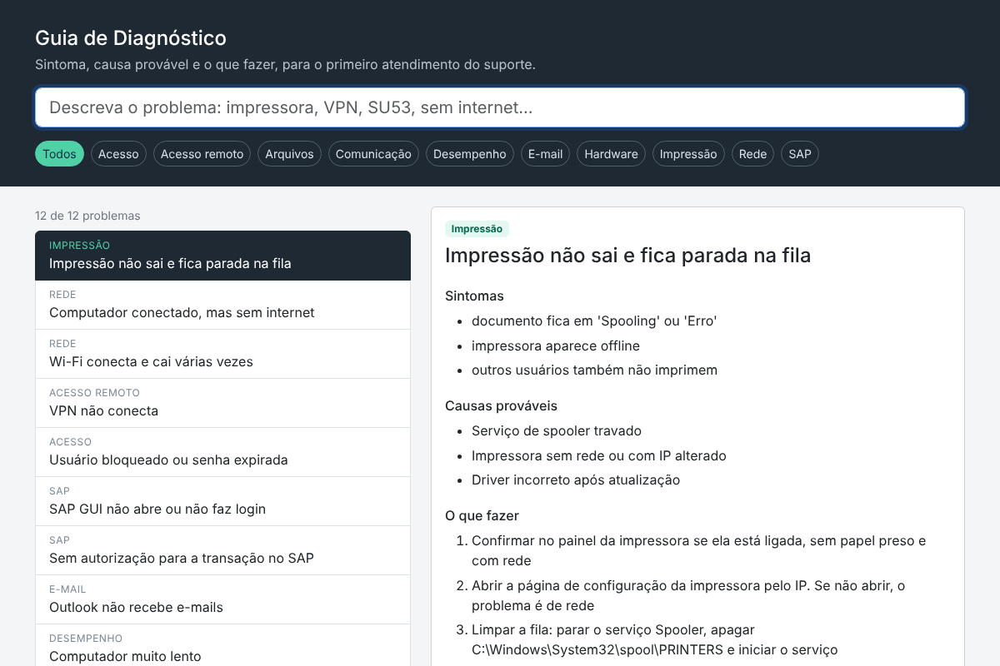

# Guia de Diagnóstico

Guia de consulta rápida para o primeiro atendimento do suporte de TI: sintoma, causa provável, passo a passo e quando escalar.

**Ao vivo:** https://leocasteletti.github.io/guia-diagnostico/

Versão genérica de um guia que criei para o suporte ao chão de fábrica. Aqui o conteúdo foi trocado por problemas comuns de qualquer empresa.



## Funcionalidades

- Busca que ignora acentos e procura em título, sintomas, causas e passos
- Filtro por família (Rede, Impressão, SAP, Acesso…)
- Link direto para cada problema (`#vpn-nao-conecta`), bom para colar em chamados
- Anotações pessoais por problema, salvas no navegador
- Funciona offline depois do primeiro acesso (Service Worker) e pode ser instalado como app

## Como adicionar um problema

Tudo vem de [`dados/diagnosticos.json`](dados/diagnosticos.json):

```json
{
  "id": "vpn-nao-conecta",
  "familia": "Acesso remoto",
  "titulo": "VPN não conecta",
  "sintomas": ["..."],
  "causas": ["..."],
  "passos": ["..."],
  "escalar": "..."
}
```

Ao publicar uma versão nova do JSON, trocar `CACHE` em `sw.js` para os navegadores baixarem a atualização.

## Rodando

```bash
python -m http.server 8000
```

O Service Worker exige `localhost` ou HTTPS.

## Stack

HTML · CSS · JavaScript puro · Bootstrap 5 · Service Worker
